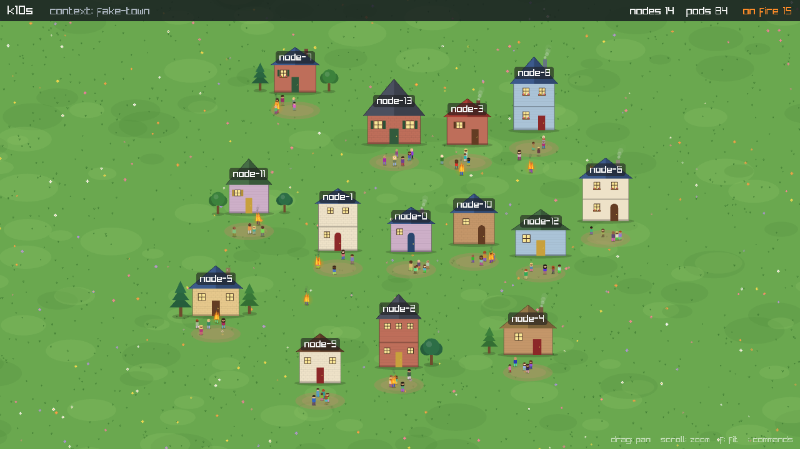

# k10s

A Kubernetes cluster viewer that draws each cluster as a village: nodes are houses, pods are villagers, and unhealthy pods run around on fire. Switch between contexts with `:ctx`, and between village, city, and beach themes with `:theme`.



## Setup

```sh
brew install michaelzheng67/tap/k10s
k10s
```

Or build from source. This requires CMake 3.25+, Ninja, and a C++20 compiler; dependencies are fetched automatically.

```sh
cmake --preset release && cmake --build --preset release
./build/release/k10s                        # uses your current kubeconfig context
```

Debug builds (`cmake --preset debug`) also include demo clusters (`fake-village`, `fake-town`) that need no Kubernetes.

Run `k10s --help` for options. Controls: drag to pan, scroll to zoom, `f` to fit. Commands: `:ctx` switches context, `:theme` switches theme, and `:q` quits.

## Under the hood

- **Lock-free SPSC ring buffer**: cluster events cross from the network thread to the render thread with no locks. It uses acquire/release atomics, and its indices are padded to separate cache lines to avoid false sharing. Stress tests run under ThreadSanitizer.
- **Snapshot + delta stream with gap recovery**: the source takes a LIST snapshot, then streams WATCH deltas ordered by `resourceVersion`. If it falls behind (`410 Gone`), it re-snapshots and diffs against known state, so stale entries are removed without a full reset.
- **Backpressure and cancellation**: when the queue is full, producers wait instead of dropping events. Threads are owned by RAII (`std::jthread` + `stop_token`), and blocking network reads are cancelled within about a second.
- **Data-oriented layout**: villagers are stored as a struct of arrays, so the per-frame update loop only touches the fields it needs. Removal is O(1) via swap-and-pop.
- **Deterministic randomness**: every appearance, building, and layout is seeded from a stable hash (FNV-1a plus a splitmix64 finalizer), so the same cluster looks the same on every run.
- **Pluggable interfaces**: data sources (fake or live cluster) and themes are abstract interfaces, so adding a new one doesn't touch the renderer.
